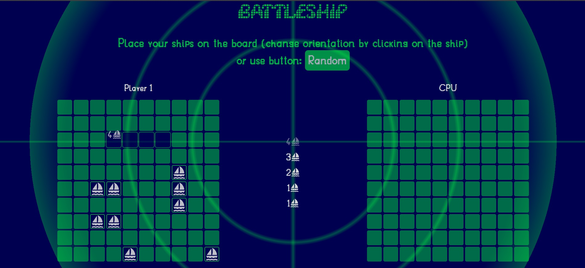
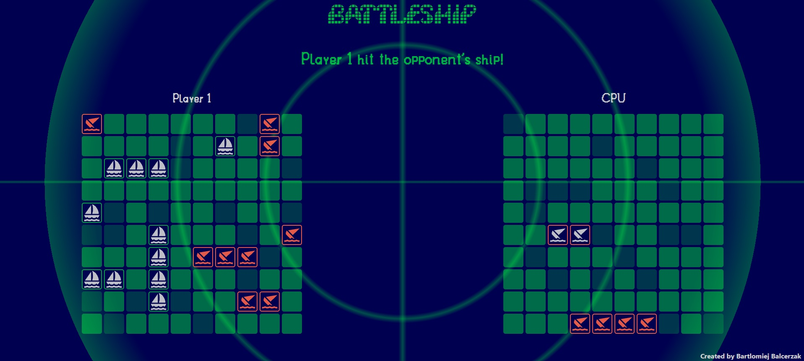
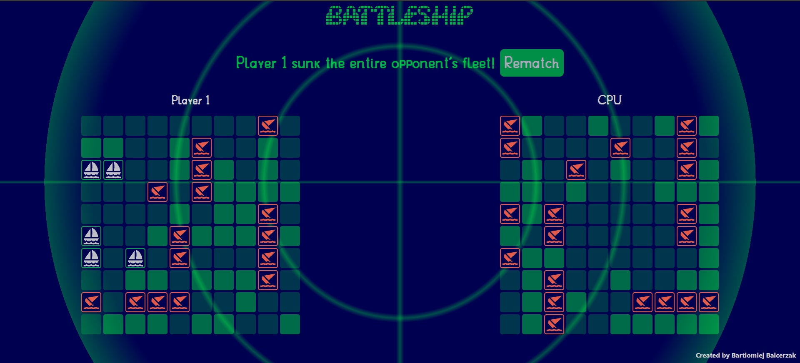

# The Odin Project > JavaScript Course > Project: Battleship

## About

Classic **Battleship** game coded in Vanilla JS built with Webpack.

**[Project requirements](https://www.theodinproject.com/lessons/node-path-javascript-battleship)**

## Live preview

**[Click!](https://bartolinidev.github.io/TOP-Battleship/)**

## Features

- Intelligent CPU player

- Drag & Drop ships placing

- Automated Tests

## Gameplay screenshots

  
  
  

